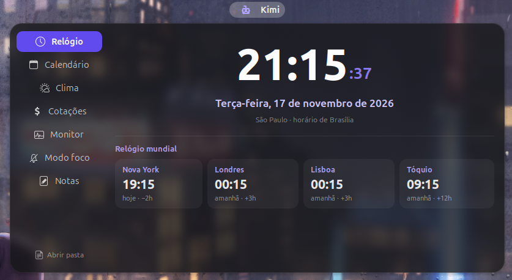
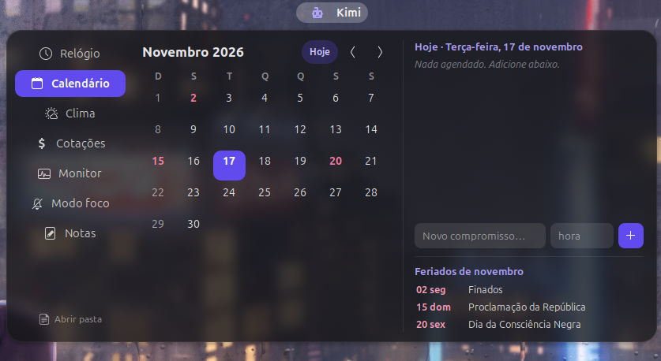
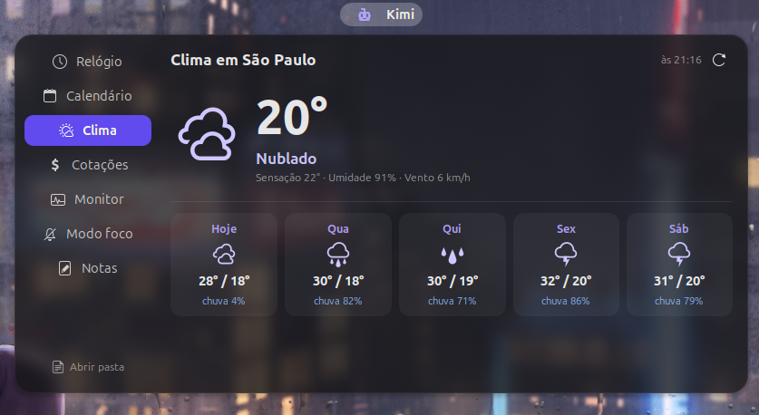
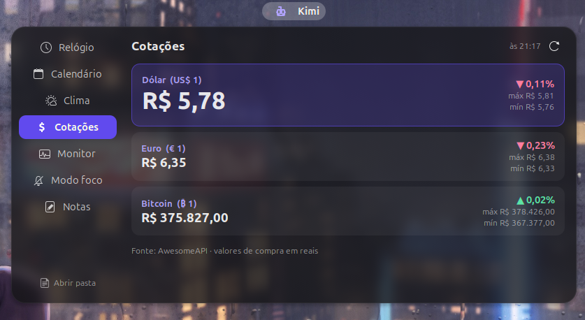
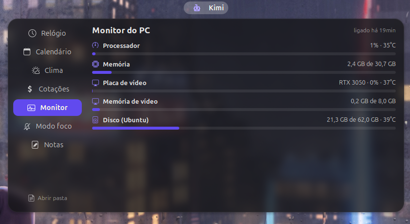
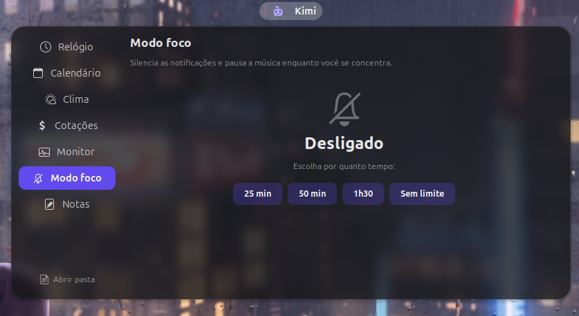
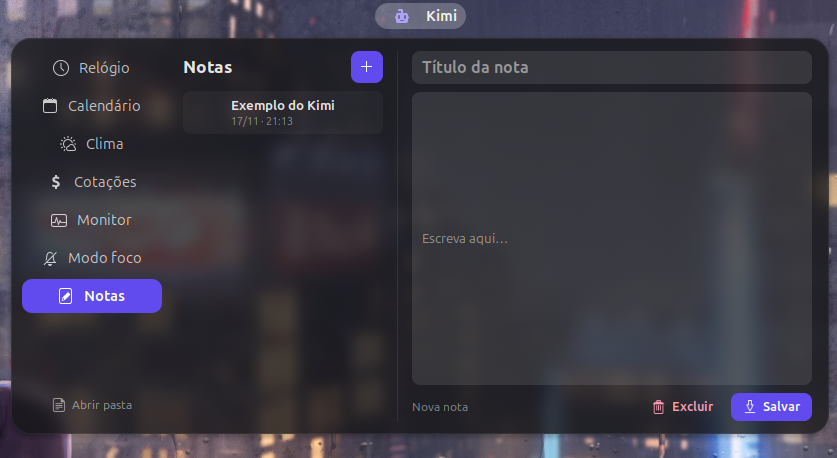

<div align="center">

# 🤖 Kimi

**Seu painel do dia a dia, direto na barra superior do GNOME.**

Relógio · Calendário com feriados do Brasil · Clima · Cotações · Monitor do PC · Modo foco · Notas


<br>



</div>

---

## ✨ O que é o Kimi?

O **Kimi** é uma extensão para o GNOME Shell que coloca um botão com um robozinho 🤖 no **centro da barra superior**. Um clique abre uma janela com **barra lateral** e sete seções, pensadas para quem usa o computador todos os dias e não quer abrir um aplicativo diferente para cada coisa.

- 🇧🇷 **Feito para o Brasil:** feriados nacionais e de São Paulo, cotações em reais e tudo em português.
- 🪶 **Leve:** os dados só são atualizados enquanto a janela está aberta.
- 🔒 **Seus dados ficam com você:** notas e agenda são arquivos comuns no seu computador, em `~/Documentos/Kimi`.
- 🎨 **Visual moderno:** tema escuro com destaque violeta (`#614AEE`), que combina com o efeito de vidro do GNOME.

---

## 📸 Capturas de tela

<table>
  <tr>
    <td align="center" width="50%"><b>📅 Calendário com feriados</b></td>
    <td align="center" width="50%"><b>⛅ Clima em São Paulo</b></td>
  </tr>
  <tr>
    <td></td>
    <td></td>
  </tr>
  <tr>
    <td align="center"><b>💲 Cotações</b></td>
    <td align="center"><b>📊 Monitor do PC</b></td>
  </tr>
  <tr>
    <td></td>
    <td></td>
  </tr>
  <tr>
    <td align="center"><b>🔕 Modo foco</b></td>
    <td align="center"><b>📝 Notas</b></td>
  </tr>
  <tr>
    <td></td>
    <td></td>
  </tr>
</table>

---

## 🧭 As seções em detalhe

### 🕐 Relógio
É a **tela principal**: o Kimi sempre abre nela.
- Hora grande com os segundos em destaque.
- Data por extenso, como "Terça-feira, 17 de novembro de 2026".
- **Relógio mundial** com Nova York, Londres, Lisboa e Tóquio. Cada cidade mostra a diferença para o horário de Brasília e se lá já é "amanhã" ou ainda é "ontem".

### 📅 Calendário
- Calendário do mês com **hoje** destacado e **feriados em rosa**.
- **Feriados nacionais**, inclusive os móveis (Carnaval, Sexta-feira Santa, Páscoa e Corpus Christi), calculados automaticamente para qualquer ano a partir da data da Páscoa.
- **Feriados de São Paulo:** Aniversário da cidade (25/01), Revolução Constitucionalista (09/07) e Corpus Christi como feriado municipal.
- **Agenda:** clique em um dia, escreva o compromisso e, se quiser, a hora (aceita `14:30` ou `9h`). Dias com compromisso ganham um pontinho.
- **Avisos:** uma notificação aparece na hora marcada. Compromissos sem hora avisam às 8h.

### ⛅ Clima
- Tempo **agora** em São Paulo: temperatura, sensação térmica, umidade e vento.
- **Previsão de 5 dias** com máxima, mínima e chance de chuva.
- Atualiza sozinho a cada 10 minutos, ou na hora pelo botão 🔄.

### 💲 Cotações
- **Dólar em destaque**, com euro e bitcoin logo abaixo, todos em reais.
- Variação do dia (▲ verde / ▼ rosa), máxima e mínima.
- Atualiza a cada 5 minutos, ou pelo botão 🔄.

### 📊 Monitor do PC
Barras que ficam rosas quando o uso passa de 85%, atualizadas a cada 2 segundos:
- **Processador**: uso e temperatura.
- **Memória** usada.
- **Placa de vídeo NVIDIA**: uso, temperatura e memória de vídeo (via `nvidia-smi`).
- **Disco** do sistema e temperatura do SSD.
- Há quanto tempo o computador está ligado.

### 🔕 Modo foco
- Escolha **25 min, 50 min, 1h30 ou sem limite**.
- Ao ligar, o Kimi **silencia as notificações** e **pausa a música** (Spotify, navegador ou qualquer player compatível).
- A **contagem regressiva** aparece na barra superior, no lugar do nome "Kimi".
- No fim, as notificações voltam e um aviso confirma que o foco terminou.

### 📝 Notas
- Lista de notas à esquerda e editor à direita.
- Cada nota vira um **arquivo `.txt`** em `~/Documentos/Kimi/Notas`, que abre em qualquer editor.
- **Salvamento automático** ao trocar de nota, mudar de seção ou fechar o Kimi.
- **Excluir** manda a nota para a lixeira, então dá para recuperar.

> 📁 O botão **Abrir pasta**, no fim da barra lateral, abre `~/Documentos/Kimi` no gerenciador de arquivos.

---

## 🚀 Instalação

### Requisitos
- **GNOME Shell 50 ou 51.** Testado no Ubuntu 26.04 LTS com Wayland.
- **Opcional:** driver NVIDIA com `nvidia-smi`, para os dados da placa de vídeo.

### Passo a passo

```bash
git clone https://github.com/Gabriel-Moreira-Valverde/kimi-gnome-extension.git
cd kimi-gnome-extension
./install.sh
```

Depois, **saia da sessão e entre de novo**. No Wayland, o GNOME só carrega extensões novas no login. Pronto: o 🤖 **Kimi** aparece no centro da barra superior.

> O `install.sh` não precisa de senha: ele copia os arquivos para `~/.local/share/gnome-shell/extensions/kimi@local` e ativa a extensão para o seu usuário.

### Desinstalar

```bash
gnome-extensions disable kimi@local
rm -rf ~/.local/share/gnome-shell/extensions/kimi@local
```

Suas notas e sua agenda continuam em `~/Documentos/Kimi`. Apague essa pasta também se quiser remover tudo.

---

## 🎨 Personalização

Tudo é configurável editando poucas linhas:

| O que mudar | Onde |
|---|---|
| Seções da barra lateral e qual abre primeiro | `SECOES` e `SECAO_PRINCIPAL` em `extension.js` |
| Cidades do relógio mundial | `CIDADES` em `dados.js` |
| Cidade do clima | `SP` em `dados.js` |
| Moedas das cotações | `MOEDAS` em `dados.js` e a URL em `buscarCotacoes()` |
| Feriados (outro estado ou cidade) | função `feriados()` em `lib.js` |
| Tempos do modo foco | `FOCO_OPCOES` em `extension.js` |
| Cores e tamanhos | `stylesheet.css` (cor principal `#614AEE`) |

Depois de editar, rode `./install.sh` de novo e saia e entre na sessão.

---

## 🗂️ Estrutura do projeto

```
kimi-gnome-extension/
├── extension.js      # interface: botão na barra, barra lateral e todas as seções
├── lib.js            # datas, feriados do Brasil/SP, agenda e notas (arquivos)
├── dados.js          # clima, cotações, monitor do PC, relógio mundial e modo foco
├── stylesheet.css    # visual
├── metadata.json     # informações da extensão para o GNOME
├── icons/            # ícone do robô
├── screenshots/      # imagens deste README
└── install.sh        # instalador
```

---

## 🔒 Privacidade

| Serviço | Para quê | O que é enviado |
|---|---|---|
| [Open-Meteo](https://open-meteo.com/) | Clima | Só as coordenadas da cidade configurada (São Paulo) |
| [AwesomeAPI](https://docs.awesomeapi.com.br/) | Cotações | Nada além do pedido das moedas |

Os dois serviços são **gratuitos e sem cadastro**. Notas, agenda e dados do monitor **nunca saem do seu computador**.

---

## 🛠️ Problemas comuns

**O Kimi não aparece na barra.**
Confira se você saiu e entrou na sessão depois de instalar. Depois rode `gnome-extensions info kimi@local` e veja se o estado é `ACTIVE`.

**A janela abre vazia ou transparente.**
Se você usa a extensão *Blur my Shell*, desative o desfoque de menus (*Menus / Popups*) nas configurações dela e teste de novo.

**A placa de vídeo não aparece no Monitor.**
Essa parte só funciona com placas NVIDIA e com o comando `nvidia-smi` instalado (ele vem junto com o driver proprietário).

**Clima ou cotações mostram "sem conexão".**
Verifique a internet e clique no botão 🔄 da seção.

---

## 📜 Créditos e licença

- Ícone do robô: `lucide-bot` do [Lucide](https://lucide.dev) (ISC), na versão do tema [Papirus](https://github.com/PapirusDevelopmentTeam/papirus-icon-theme) (GPL-3.0).
- Dados de clima por [Open-Meteo](https://open-meteo.com/) e de cotações por [AwesomeAPI](https://docs.awesomeapi.com.br/).
- Código licenciado sob a **[GPL-3.0](LICENSE)**: use, estude, modifique e compartilhe.

<div align="center">

<br>

Feito com 💜 no Brasil

</div>
